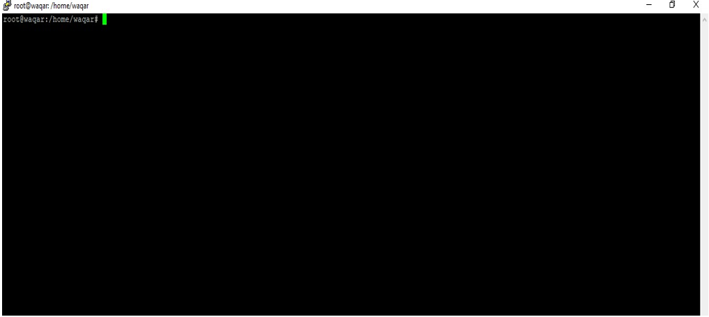

# Wazuh + Suricata Integration

## Project Overview

This lab demonstrates how to integrate **Suricata IDS** with **Wazuh** for network threat detection.

We install Suricata on Ubuntu, load the Emerging Threats open ruleset, configure Suricata to monitor network traffic, and forward Suricata alerts to the Wazuh manager so they appear on the Wazuh Dashboard.

## Lab Objectives

- Install and configure Suricata on Ubuntu Server
- Load Emerging Threats open ruleset
- Configure Suricata to monitor the correct network interface
- Forward Suricata eve.json logs to Wazuh
- Verify alerts appear on the Wazuh Dashboard

---

## Lab Architecture
buntu Server (Suricata)
│
│ Suricata alerts (eve.json)
▼
Wazuh Agent
│
▼
Wazuh Manager
│
▼
Wazuh Dashboard

---

## Step-by-Step Guide

### 1. Set up Ubuntu Server
Install Ubuntu Live Server and access it via SSH (PuTTY).



### 2. Add Suricata Stable PPA
```bash
sudo add-apt-repository ppa:oisf/suricata-stable
3. Update the system
Bashsudo apt-get update

4. Install Suricata
Bashsudo apt-get install suricata -y

5. Download Emerging Threats Ruleset
Bashcd /tmp/ && curl -LO https://rules.emergingthreats.net/open/suricata-6.0.8/emerging.rules.tar.gz

6. Extract the rules
Bashsudo tar -xvzf emerging.rules.tar.gz

7. Create rules directory
Bashsudo mkdir /etc/suricata/rules

8. Move rules into Suricata directory
Bashsudo mv rules/*.rules /etc/suricata/rules/

9. Set proper permissions
Bashsudo chmod 640 /etc/suricata/rules/*.rules

10. Configure Suricata (/etc/suricata/suricata.yaml)

Find your network interface using ifconfig
Set the correct interface under af-packet
Configure the rules path:

YAMLdefault-rule-path: /etc/suricata/rules
rule-files:
  - "*.rules"


11. Restart Suricata
Bashsudo systemctl restart suricata

12. Configure Wazuh Agent (/var/ossec/etc/ossec.conf)
Add the following localfile configuration:
XML<localfile>
  <log_format>json</log_format>
  <location>/var/log/suricata/eve.json</location>
</localfile>

13. Restart Wazuh Agent
Bashsudo systemctl restart wazuh-agent

14. Generate traffic and verify alerts
Ping or generate network traffic. You should now see Suricata alerts on the Wazuh Dashboard.


Key Learning Outcomes

Installing and configuring Suricata IDS
Loading third-party rulesets (Emerging Threats)
Forwarding Suricata logs to Wazuh using ossec.conf
Viewing network-based alerts on the Wazuh Dashboard
End-to-end IDS + SIEM integration


Project Files

Full Lab PDF [blocked] (original document)
All screenshots are available in the Evidence/ folder


Lab Created by: Sayed Waqar Ali Bacha

LinkedIn: www.linkedin.com/in/waqar-ali-8a5b6b228

GitHub: https://github.com/waqar5289